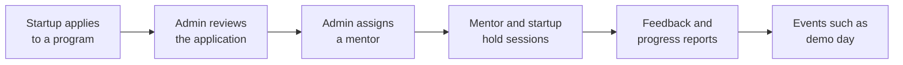

# Startup Incubation Management App


> A web app that runs a startup incubation program from end to end: startups
> apply, administrators review and assign mentors, mentors book sessions and
> give feedback, and everyone can see progress.

## In plain terms

**The problem.** An incubator (an organisation that helps new businesses get
started) usually tracks applications, mentor pairings, meetings and progress
across emails and spreadsheets. Things get lost, and nobody has the full picture.

**What this app does.** It puts all of that in one place, with a different view
for each kind of person:

| If you are… | You can… |
|---|---|
| **A startup** | Apply to a program, see the status of your application, book sessions with your mentor, report progress, register for events |
| **A mentor** | Set when you are available, see the startups assigned to you, run sessions, give feedback |
| **An administrator** | Create programs, review applications, assign mentors to startups, schedule events, read reports |

## How it works



Each person signs in with their own account, and the app only shows them the
screens their role is allowed to use.

## Technology

| Layer | What is used |
|---|---|
| Backend | Node.js, Express, MongoDB (Mongoose), JWT sign-in, Joi request validation |
| Frontend | React 18, React Router, Axios, Bootstrap and Tailwind CSS |
| Testing | Mocha, Chai and Sinon (backend controllers and domain logic) |
| Delivery | GitHub Actions on a self-hosted runner, PM2 process manager, AWS EC2 |

### Design patterns

The backend was built to demonstrate object-oriented design patterns, and each
one lives in its own folder so it is easy to find:

| Pattern | Where | What it is used for |
|---|---|---|
| Repository | `backend/repositories/` | Keeps database queries out of the controllers |
| Factory | `backend/domain/factory/` | Creates the right kind of user, mentor or application object |
| Strategy | `backend/domain/strategy/` | Swaps behaviour for different kinds of user and application |
| Decorator | `backend/domain/decorators/` | Adds behaviour to an application without changing its class |
| Proxy | `backend/middleware/roleProxy.js` | Checks a user's role before a request reaches the controller |

## Project structure

```plaintext
simappA2/
├── backend/
│   ├── controllers/      # Request handlers (12 feature areas)
│   ├── domain/           # Business objects, factories, strategies, decorators
│   ├── repositories/     # Database access
│   ├── models/           # Mongoose schemas
│   ├── middleware/       # Sign-in check, role check, request validation
│   ├── routes/           # API routes
│   ├── APICollections/   # Postman collections for every feature and role
│   └── test/             # Mocha tests
├── frontend/
│   └── src/              # React pages, components, context, services
└── .github/workflows/    # CI pipeline
```

---

## Installation & Setup

### Prerequisites

- Node.js (v14 or higher)
- npm or yarn
- MongoDB (local instance or MongoDB Atlas)
- Git

### Backend Setup

1. Clone the repository:
   ```bash
   git clone https://github.com/bajundotdev/simappA2.git
   cd simappA2
   ```

2. Install backend dependencies:
   ```bash
   cd backend
   npm install
   ```

3. Create a `.env` file in the backend directory with the following variables:
   ```
   PORT=5001
   MONGO_URI=your_mongodb_connection_string
   JWT_SECRET=your_jwt_secret_key
   NODE_ENV=development
   ```

### Frontend Setup

1. Install frontend dependencies:
   ```bash
   cd ../frontend
   npm install
   ```

2. Create a `.env` file in the frontend directory (optional for custom configuration):
   ```
   REACT_APP_API_URL=http://localhost:5001/api
   ```

### Database Setup

1. Ensure MongoDB is running on your local machine or you have access to a MongoDB Atlas cluster
2. The application will automatically create the required collections when it first connects to the database

---

## Running the Application

### Development Mode

1. Start the backend server:
   ```bash
   cd backend
   npm run dev
   ```

2. In a separate terminal, start the frontend development server:
   ```bash
   cd frontend
   npm start
   ```

3. Access the application at `http://localhost:3000`

### Production Mode

1. Build the frontend:
   ```bash
   cd frontend
   npm run build
   ```

2. Start the backend server:
   ```bash
   cd ../backend
   npm start
   ```

3. The complete application will be served from `http://localhost:5001`


---

## Tests

```bash
cd backend
npm test
```

## API overview

All routes are under `/api`. The Postman collections in `backend/APICollections/`
contain ready-made requests for each one, grouped by feature and by role.

| Area | Base path |
|---|---|
| Sign-in and registration | `/api/auth` |
| User profile | `/api/user` |
| Programs | `/api/programs` |
| Applications | `/api/applications` |
| Mentors | `/api/mentor` |
| Mentor assignment | `/api/assignment` |
| Mentor availability | `/api/availability` |
| Sessions | `/api/sessions` |
| Progress | `/api/progress` |
| Feedback | `/api/feedback` |
| Reports | `/api/reports` |
| Events | `/api/events` |

## Status

A university group project, built for the IFN636 unit at Queensland University
of Technology in 2025. It is not maintained as a
product and the original demo server is no longer advertised here.

## Contributors

- [bajundotdev](https://github.com/bajundotdev)
- [MKRCabanero](https://github.com/MKRCabanero)
- [tomsecundo](https://github.com/tomsecundo)
